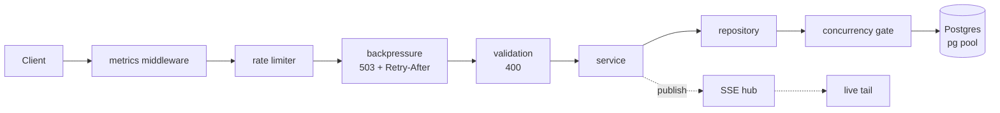

# LogForge

Centralized logging for distributed services: an ingest API, fast search, a live tail, and the observability to show where it breaks.

**Stack:** Node 22, Express 5, PostgreSQL (`pg`), vanilla JS front end, no build step.

## Run it

```bash
docker compose up -d                 # Postgres on :5440 (dev credentials)
cd server
cp .env.example .env
npm install
npm run db:setup                     # creates the table and indexes
npm start                            # http://localhost:3100
```

- `/` is a **guided 3D tour** in seven chapters, where every log is a cube you can count and inspect and every timing is measured on your server. Start there. It needs WebGL2 for the visuals; without it the controls and measurements still work.
- `/console.html` is the live console: load generator, benchmark, live tail, search, server vitals.

## Deploy to Render

[](https://render.com/deploy?repo=https://github.com/CyberSarvesh/LogForge)

[`render.yaml`](render.yaml) creates a free web service and a free Postgres, connects them and creates the schema.

1. Push to `main`. Render reads the repository, not your working copy.
2. In the [Render dashboard](https://dashboard.render.com), choose **New > Blueprint** and connect the repository.
3. Check that both resources say **Free**, then click **Deploy Blueprint**.
4. Open `https://<your-service>.onrender.com`. Sample data appears shortly after the first start.

What the free plan means:

- **The database expires 30 days after creation.** Render deletes it 14 days later unless you upgrade. To start over, delete it and sync the Blueprint again.
- **One free database per workspace.** If you already have one, the Blueprint can't create another.
- **The service sleeps after 15 idle minutes** and takes about a minute to wake. Open it before you present.
- **It is small** (0.1 CPU, 512 MB), so expect far lower numbers than on a laptop.

The Blueprint sets `PUBLIC_DEMO=true`, because anyone can reach the site:

| | Localhost | Public demo |
|---|---|---|
| "Break it" chapter | sabotages the real server | labelled simulation in the visitor's browser |
| Search race | unlimited | read-only, one at a time, 20/min per IP |
| Demo config and reset API | local same-origin only | off |
| Request bodies | 5 MB | 512 KB, uncompressed |
| Live tails | unlimited | 300 in total, 40 per IP |
| Data | yours | **disposable**: an unlogged table, wiped back to samples at 200 MB (`DEMO_RESET_AT_MB`) |

Ingest has no authentication, so visitors can write any text into a public demo's logs. Don't send real logs to one. For real use, remove `PUBLIC_DEMO` and `DEMO_RESET_AT_MB` and add authentication first.

## Architecture



```
server/
  routes/         /api router (health, metrics, logs, demo)
  middlewares/    metrics, rate limit, backpressure, error handling
  modules/logs/   routes → controller → service → repository (+ schema validation, SSE hub)
  modules/demo/   dev-only chaos controls and EXPLAIN race (ENABLE_DEMO)
  db/             pool + concurrency gate, schema.sql, setup script
  public/         guided tour (index.html) and console (console.html)
    tour/
      engine/     dependency-free WebGL2 renderer: instancing, shadows, camera
      lib/        API client, 3D props, labels, live tail
      chapters/   one file per chapter
```

## API

| Method | Path | Purpose |
|---|---|---|
| POST | `/api/logs` | Ingest one log `{service, level, message, metadata?}` |
| POST | `/api/logs/batch` | Ingest up to 1000 logs in one statement |
| GET | `/api/logs` | Search: `service`, `level`, `search`, `before` (cursor), `limit` (≤500) |
| GET | `/api/logs/stats` | Per-level time series and top services |
| GET | `/api/logs/stream` | Live tail over Server-Sent Events |
| GET | `/api/metrics` | CPU, event-loop lag, in-flight, gate usage, per-query timings, outcome counts |
| GET | `/api/health` | Readiness: DB round-trip time |
| GET | `/api/live` | Liveness for the host, doesn't touch the DB |

## Design decisions

- **Batched ingest.** One `INSERT … SELECT FROM unnest(arrays)` per batch: one round trip and one statement for up to 1000 rows.
- **Trigram GIN index** on `message`, so `ILIKE '%term%'` search stays in milliseconds on millions of rows.
- **Keyset pagination** on `id` instead of `OFFSET`: constant cost at any depth.
- **Concurrency gate** in front of Postgres (`db/client.js`): a bulkhead whose size and wait queue are observable. pg's own queue is hidden and its size can't change at runtime.
- **Load shedding.** When the queue is full the API returns `503` + `Retry-After` immediately, so latency stays bounded instead of the process collapsing under queued work.
- **SSE with coalescing.** Bursts are buffered and flushed four times a second, so a 20k logs/s flood can't swamp browsers.
- **Single-flight stats cache.** Dashboard aggregates share one query per second so reads don't compete with writes.
- **Observability built in.** Event-loop lag, gate saturation, and queue-wait vs query time are first-class metrics, and the UI uses them to name the bottleneck.
- **Safe by default.** Demo endpoints (which can slow the DB on purpose) are off in production unless `ENABLE_DEMO=true`. Where they are on, `/api/demo/*` only answers same-origin requests from the machine running the server (`middlewares/localOnly.middleware.js`), so other websites, LAN devices and proxied callers get `403`. Log ingest still accepts any origin.
  - To use the tour's "Break it" and search chapters, open it at `localhost`, `127.0.0.1` or `[::1]`. Through a LAN IP, a tunnel or a Docker port mapping, "Break it" runs as a simulation and the search race is refused.

## Measured results (one dev machine, your numbers will differ)

- Batching 500 logs/request vs one log/request: roughly **40–80× more logs/sec**.
- Trigram index vs full scan on 2.4M rows: **13–17× faster** (about 1.1 s → 70 ms for a selective phrase).
- Write throughput falls as the table grows (about 22k logs/s at 130k rows, about 7k at 2.4M) because the trigram index trades slower writes for fast search. See the "Find the limit" ramp.

The load generator runs in the browser (6 connections per host), so it is part of the ceiling. Use k6 or autocannon to push further.

## Known limits and next steps

- No authentication or per-service API keys.
- No retention policy or table partitioning (the next lever for write speed and cleanup).
- Horizontal scaling needs Redis pub/sub for the live tail and a shared rate-limit store.
- No automated tests yet.
